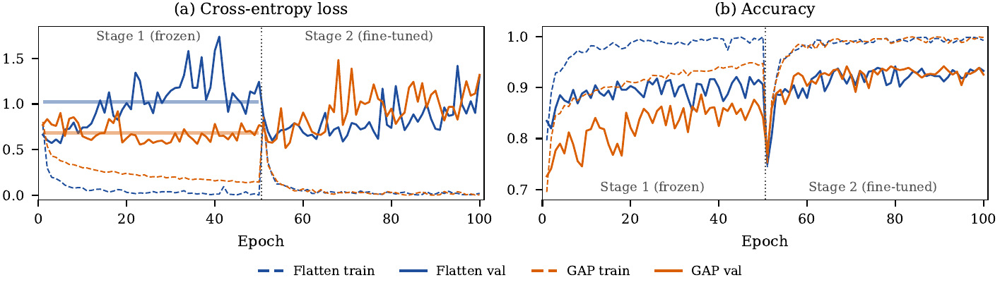
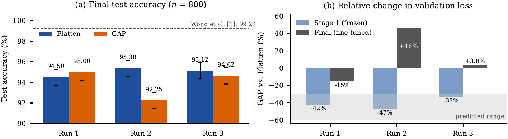
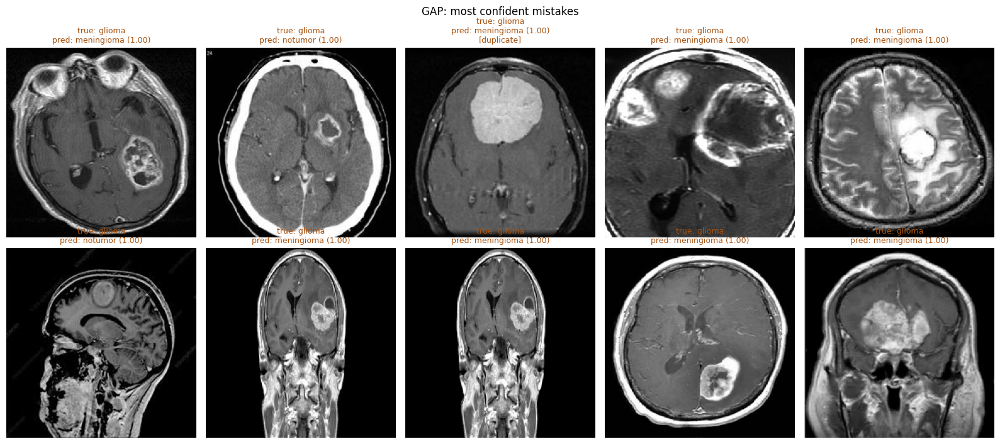
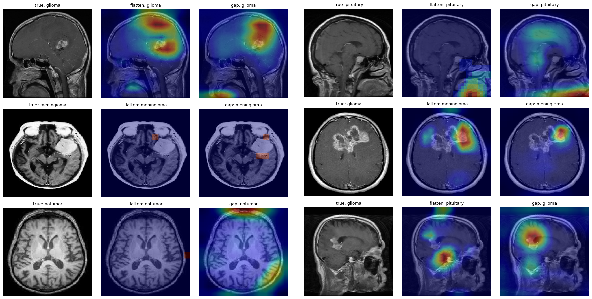

# Flatten or Pool?

**Does Global Average Pooling stop a VGG16 brain-tumour classifier from overfitting?**

A reproduction of Wong *et al.* (2025) and a pre-registered ablation study.

[](paper/CV_Project_Report.pdf)
[](https://www.kaggle.com/code/astrodally/cv-project)
[](https://www.kaggle.com/code/astrodally/cv-project-h1)
[](https://www.tensorflow.org/)



## TL;DR

A published VGG16 model claims **99.24%** accuracy on four-class brain tumour MRI classification. We reimplemented it and got **95.25%**, and found that a quarter of the test images are copies of training images.

The model clearly overfits, so we tested an obvious fix: swap the 6.4 M-parameter `Flatten` head for a 0.13 M-parameter `GlobalAveragePooling2D` head. Across three identical runs, GAP cut validation loss by 33–47% while the backbone was frozen. Once fine-tuning started, the benefit vanished.

> **Fine-tuning, not the classifier head, drives the overfitting.**

## Highlights

- **99.24% → 95.25%.** The published result did not reproduce under a faithful reimplementation.
- **25% of the test set leaks.** 202 of 800 test images are pixel-identical to training images. Accuracy is 99.5% on those and 93.8% on the rest.
- **GAP helps, then stops helping.** It halves overfitting with a frozen backbone, but unfreezing VGG16 blocks 4–5 adds 12.98 M trainable weights and erases the difference.
- **Same seed, different answers.** Identical runs diverged after epoch 12. GAP's accuracy varied by 2.75 points, as much as the effect we were trying to measure.

## Results

### Reproduction

| | Accuracy |
|:--|--:|
| Wong *et al.* (2025), reported | 99.24% |
| Our reproduction, full test set (n = 800) | **95.25%** |
| ↳ on test images leaked from training (n = 202) | 99.50% |
| ↳ on unseen test images (n = 598) | 93.81% |

Glioma is the weak point: 84.5% recall, with most missed gliomas predicted as meningioma.

### Flatten vs. GAP



| Flatten → GAP | Run 1 | Run 2 | Run 3 |
|:--|:--:|:--:|:--:|
| Test accuracy (%) | 94.50 → 95.00 | 95.38 → 92.25 | 95.13 → 94.63 |
| Glioma recall (%) | 81.5 → 83.0 | 85.0 → 72.5 | 82.5 → 81.5 |
| Final validation loss | −15% | +46% | +3.8% |
| Stage-1 validation loss (frozen backbone) | **−42%** | **−47%** | **−33%** |

### Did the predictions hold?

We wrote these down before running anything.

| Prediction | Outcome |
|:--|:--|
| Test accuracy +1 to +3 points | ✗ Not supported |
| Validation loss 30–60% lower | ✗ Not supported |
| Smaller train–validation gap | ✗ Refuted, larger in every run |
| Higher glioma recall | ✗ Not supported |
| Slightly higher macro AUC | ~ Inconclusive (changes ≤ 0.004) |
| *Risk:* pituitary recall may drop | ~ Dropped ≤ 1 point in two runs, rose in one |
| *(Stage-1 validation loss lower)* | ✓ **Replicated in all three runs** |

### Why GAP stopped helping

| Trainable parameters | Flatten | GAP | Ratio |
|:--|--:|--:|:--:|
| Stage 1 (backbone frozen) | 6.42 M | 0.13 M | **48.5×** |
| Stage 2 (+ VGG16 blocks 4–5) | 19.40 M | 13.11 M | **1.48×** |

During fine-tuning the backbone dominates both models. With 13–19 M trainable weights and a fixed set of 16,800 augmented images, both reach ~100% training accuracy and overfit equally.

### Failure analysis

Almost every error is a missed glioma, usually predicted as meningioma with ~100% confidence. Large, sharply outlined gliomas look like meningiomas, and the dataset mixes MRI sequences, includes a CT-like image and contains duplicates.



Grad-CAM shows that neither model consistently focuses on the tumour:



## Method

```
MRI → grayscale 224×224 → offline augmentation ×3 → VGG16 (ImageNet) → Flatten │ GAP → Dense(256) → Softmax(4)
```

| | Trainable | Optimiser | Epochs |
|:--|:--|:--|:--:|
| Stage 1 | head only | Adam, lr 1e-3 | 50 |
| Stage 2 | head + VGG16 blocks 4–5 | Adam, lr 1e-4 | 50 |

Batch size 32 · 179 steps per epoch · seed 42 · only the pooling layer differs between the two models.

### Dataset and leakage audit

[Brain Tumor MRI Dataset](https://www.kaggle.com/datasets/masoudnickparvar/brain-tumor-mri-dataset): 7,200 images, balanced across glioma, meningioma, pituitary tumour and no tumour.

| Split | Images |
|:--|--:|
| Train (×3 offline augmentation) | 16,800 |
| Validation | 800 |
| Test | 800 |

Leakage was detected with 64-bit difference hashes: any test image whose hash exactly matches a training image is flagged. Near-duplicates and same-patient slices are not caught, so 202 is a lower bound.

### Settings the original paper doesn't specify

| Setting | Our choice |
|:--|:--|
| Shear / zoom | 0.2 / 0.2, nearest fill |
| Loss | categorical cross-entropy |
| Online augmentation | off |
| Early stopping | off (paper trains the full 50 + 50 epochs) |
| "First ten layers" frozen | `base_model.layers[:10]` |
| Normalisation | rescale 1/255 |

## Getting started

### Run on Kaggle (recommended)

1. Open the [reproduction](https://www.kaggle.com/code/astrodally/cv-project) or [ablation](https://www.kaggle.com/code/astrodally/cv-project-h1) notebook and click **Copy & Edit**.
2. Attach the [Brain Tumor MRI Dataset](https://www.kaggle.com/datasets/masoudnickparvar/brain-tumor-mri-dataset) and set the accelerator to **GPU T4 ×2**.
3. Click **Save Version → Save & Run All**. A full run takes about 2–2.5 hours.

### Run locally

```bash
git clone https://github.com/astro-dally/flatten-or-pool.git
cd flatten-or-pool
pip install tensorflow tf_keras kagglehub seaborn scikit-learn pillow dash
```

Set `DATA_ROOT = None` in the notebook's configuration cell and the dataset downloads automatically.

> **Note:** The trained models (240 MB and 164 MB) are too large for GitHub. Download them from the **Output** tab of the [ablation notebook](https://www.kaggle.com/code/astrodally/cv-project-h1).

## Repository

```
flatten-or-pool/
├── notebooks/
│   ├── cv-project.ipynb          reproduction of Wong et al. (2025)
│   └── cv-project-h1.ipynb       Flatten vs. GAP ablation + failure analysis
├── paper/
│   └── CV_Project_Report.pdf     full write-up (IEEE format)
├── presentation/
│   └── final_presentation.pdf
└── results/
    ├── figures/                  curves, confusion matrices, Grad-CAM, errors
    ├── histories/                per-epoch training logs
    └── tables/                   reproduction, leakage, ablation results (CSV)
```

## Limitations

- **Image-level split.** The dataset has no patient IDs, so slices of the same patient may land in both train and test.
- **Three runs per model.** Enough to see the spread, not enough for tight confidence intervals.
- **Different dataset release.** Ours has 7,200 images; the paper used 7,023.
- **Not a medical device.** This is a methods study on a public benchmark, not validated for clinical use.


## Acknowledgements

Built on [Wong *et al.*, "Brain tumor classification using MRI images and deep learning techniques," *PLoS ONE* 20(5): e0322624, 2025](https://doi.org/10.1371/journal.pone.0322624), and the [Brain Tumor MRI Dataset](https://www.kaggle.com/datasets/masoudnickparvar/brain-tumor-mri-dataset) by Masoud Nickparvar. Compute provided by Kaggle.
